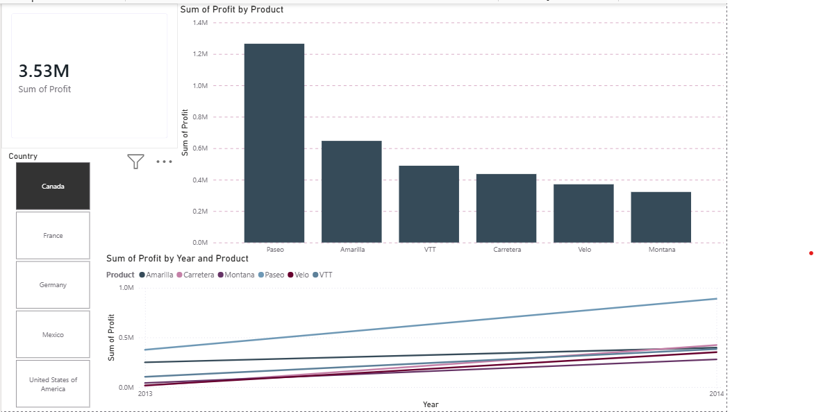

# Power BI Executive Dashboard

Interactive executive dashboard built with Power BI for financial performance tracking.

## Features
- KPI overview (Revenue, Profit, Expenses)
- Drill-down by product / region / time
- Executive summary visuals

## Files
- `Financial_Executive_Dashboard.pbix` - Main Power BI file
- `Dashboard_screenshot.png` - Preview

## Tools
Power BI Desktop, DAX, Power Query

## How to Use
1. Open .pbix in Power BI Desktop
2. Refresh data if needed
3. Interact with slicers

